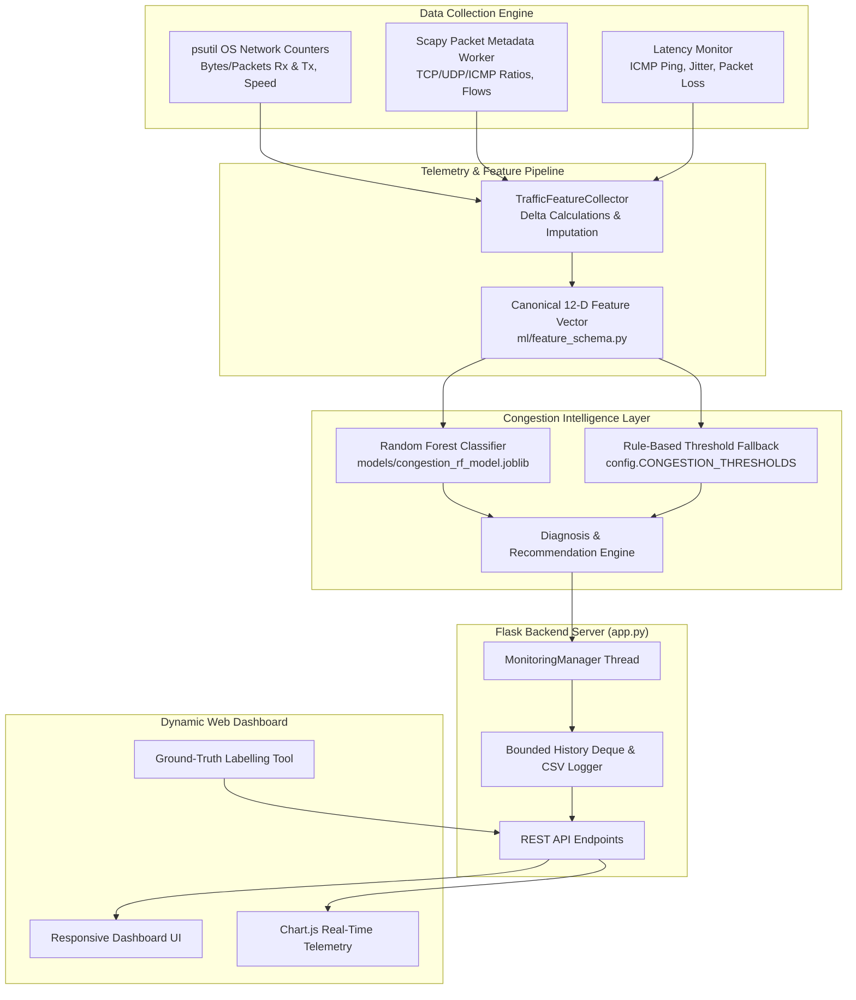

# AI Network Traffic Analyzer & Congestion Prediction System

An end-to-end, real-time Computer Networks and Applied Machine Learning system built for Windows. It monitors live network adapter traffic, captures packet metadata, performs statistical queue and flow rate analysis, predicts network congestion levels via Random Forest classification, and visualizes dynamic telemetry on a responsive web dashboard.

---

## 1. Project Overview

Modern high-speed computer networks suffer from transient queuing delays, bufferbloat, and burst packet drops. Traditional passive monitoring tools (like standard SNMP polling or task managers) display raw bandwidth counters without diagnosing whether link saturation or queuing collapse is occurring.

This project bridges **Computer Networking** and **Machine Learning** by:
1. **Measuring Real Network Metrics**: Reading OS-level kernel network counters via `psutil` (throughput, packet rates, interface speed) and aggregating packet metadata via `scapy` (TCP/UDP/ICMP protocol breakdowns, average packet size, unique active 5-tuple conversations).
2. **Probing Path Quality**: Actively measuring round-trip latency, successive-probe jitter, and packet loss using ICMP ping probes.
3. **Machine Learning Inference**: Predicting network congestion into three distinct operational states:
   - **Low Congestion (Normal)**
   - **Medium Congestion (Elevated Load / Video Burst)**
   - **High Congestion (Queue Saturation / Bufferbloat / Bottleneck Link Collapse)**
4. **Interactive Dashboard**: Providing real-time dynamic Chart.js visualizations, cooldown-governed anomaly alerts, real-world data collection/labelling tools, and a zero-dependency **Demo Mode** for presentations.

---

## 2. System Architecture & Data Flow



### Complete Data Flow:
1. **Sampling Tick**: The background monitoring thread triggers every 1.0 second.
2. **OS Counter Deltas**: `psutil.net_io_counters(pernic=True)` extracts the byte and packet difference over elapsed time $\Delta t$, calculating accurate **Download Mbps**, **Upload Mbps**, and **PPS**.
3. **Safe Packet Inspection**: Scapy runs in memory with `store=False`, capturing layer headers only (never payloads or passwords) to measure protocol ratios and active 5-tuple flows.
4. **Active Quality Probing**: `LatencyMonitor` probes the configured gateway or DNS target (e.g. `8.8.8.8`) to record round-trip latency, jitter ($|L_t - L_{t-1}|$), and rolling packet loss percentage.
5. **Feature Vector Extraction**: Features are validated and ordered into the strict canonical schema in `ml/feature_schema.py`.
6. **Classification & Probability**: The Random Forest model outputs class predictions and statistical confidence probabilities ($P(\text{Low}), P(\text{Medium}), P(\text{High})$). If the model is not trained, the rule-based fallback evaluates threshold boundaries.
7. **Dashboard Streaming**: The frontend polls `/api/stats` and `/api/history` every 1.5 seconds, updating 5 real-time Chart.js charts and 9 key metric cards.

---

## 3. Technology Stack

| Domain | Technology | Purpose |
|---|---|---|
| **Web Server & API** | Python 3.10+, Flask 3.x | Lightweight HTTP server, REST API, thread management |
| **OS Network Telemetry** | `psutil` | Kernel network interface discovery, bytes/packets counters, adapter link speeds |
| **Packet Metadata Sniffing** | `scapy` | Deep packet inspection, protocol breakdown (TCP/UDP/ICMP), flow tracking |
| **Active Probing** | Windows ICMP Subprocess | Round-trip latency, successive delay jitter, rolling packet loss |
| **Machine Learning** | `scikit-learn` | Random Forest Classifier, stratified train/test split, confusion matrix |
| **Data Handling** | `pandas`, `numpy` | Feature schema validation, data formatting, vector processing |
| **Model Persistence** | `joblib` | Binary serialization of trained estimators |
| **Visual Reports** | `matplotlib` | High-resolution evaluation charts (confusion matrix, feature importances) |
| **Frontend UI** | HTML5, CSS3, Vanilla JS | Single-page responsive light dashboard |
| **Dynamic Graphing** | Chart.js 4.x (CDN) | Real-time dual-line throughput, PPS, latency/jitter, protocol doughnut, and state history charts |

---

## 4. Project Directory Structure

```text
c:\Users\Tamilarasi\OneDrive\Documents\cn project\
├── app.py                      # Main Flask application and background monitoring manager
├── config.py                   # Centralized application, path, and threshold configuration
├── requirements.txt            # Python dependencies
├── train_model.py              # CLI training script with dataset validation and reporting
├── start_app.bat               # Windows one-click startup batch script
├── README.md                   # Comprehensive system documentation and viva guide
├── data/
│   ├── README.md               # Dataset descriptions and feature dictionary
│   ├── demo_training_data.csv  # Synthetic bootstrap training dataset
│   ├── live_observations.csv   # Automatically recorded live measurement log
│   └── labelled_observations.csv # User-verified labelled samples for model retraining
├── models/
│   ├── congestion_rf_model.joblib # Serialized Random Forest model artifact
│   └── model_metadata.json     # Training metadata, test accuracy, hyperparameters, and disclaimer
├── reports/
│   ├── confusion_matrix.png    # Test set confusion matrix visualization
│   └── feature_importance.png  # Random Forest feature importance bar chart
├── network/
│   ├── __init__.py
│   ├── interface_manager.py    # Adapter discovery, speed detection, status validation
│   ├── packet_capture.py       # Safe Scapy background packet sniffer with store=False
│   ├── latency_monitor.py      # ICMP ping probing, jitter calculation, packet loss tracking
│   └── traffic_features.py     # Delta rate computations and controlled demo data generator
├── ml/
│   ├── __init__.py
│   ├── feature_schema.py       # Canonical 12-feature schema, imputation defaults, validation
│   ├── predictor.py            # Model inference, confidence calculation, rule-based fallback
│   └── trainer.py              # Synthetic bootstrap generation, Random Forest training pipeline
├── templates/
│   └── index.html              # Responsive single-page web dashboard
├── static/
│   ├── css/
│   │   └── style.css           # Professional light-theme CSS
│   └── js/
│       └── dashboard.js        # Polling controller, UI state manager, Chart.js visualizer
└── tests/
    ├── test_features.py        # Tests for deltas, sanitization, mock aggregation, demo generator
    ├── test_ml.py              # Tests for dataset validation, rule evaluator, prediction pipeline
    └── test_api.py             # Tests for Flask API endpoints and lifecycle controls
```

---

## 5. Windows Installation & Setup Guide

### Prerequisites
- Windows 10 or 11
- Python 3.10, 3.11, 3.12, or 3.13 installed (ensure **"Add Python to PATH"** was checked during installation).
- [Npcap for Windows](https://npcap.com/#download) (Optional for standard user throughput monitoring; **Required** for Scapy raw packet inspection).

### Step 1: Clone or Navigate to the Workspace
Open PowerShell or Command Prompt:
```cmd
cd "c:\Users\Tamilarasi\OneDrive\Documents\cn project"
```

### Step 2: Set Up Python Virtual Environment (Recommended)
```cmd
python -m venv venv
venv\Scripts\activate
```

### Step 3: Install Required Dependencies
```cmd
pip install -r requirements.txt
```

### Step 4: Install Npcap (For Raw Packet Protocol Breakdown)
1. Download the official Npcap installer from [https://npcap.com/#download](https://npcap.com/#download).
2. Run the installer (`npcap-x.xx.exe`).
3. **Important Installation Note**: If you select the default *"Restrict Npcap driver's access to Administrators only"*, you must launch PowerShell or Command Prompt with **"Run as Administrator"** to enable Scapy packet capture.
4. *Graceful Fallback*: If Npcap is missing or you run without Administrator privileges, the system automatically runs in **Graceful Degraded Mode**: all OS network throughput (Mbps), packet rates (PPS), and bandwidth utilization continue running accurately via `psutil`.

---

## 6. How to Run the Application

### Option A: Using the Windows Batch Script (Easiest)
Simply double-click `start_app.bat` or run:
```cmd
start_app.bat
```
The script automatically verifies Python, checks for a trained model (auto-generates one if missing), and launches Flask on `http://127.0.0.1:5000`.

### Option B: Using Python Directly
```cmd
python app.py
```
Open your browser and navigate to:
```
http://127.0.0.1:5000
```

---

## 7. Operating Modes: Live Mode vs. Demo Mode

| Feature | Live Mode | Demo Mode |
|---|---|---|
| **Data Source** | Actual physical network adapter counters (psutil) + Scapy packets | Controlled synthetic simulation generator |
| **Integrity Rule** | **Never** uses Math.random() or fabricated data | Controlled physics-based network models |
| **Indicator Pill** | `[LIVE NETWORK DATA]` (Blue) | `[DEMO DATA — NOT LIVE]` (Amber) |
| **Permissions Required** | Standard user for bandwidth; Admin for Scapy deep packet inspection | None (Runs in any environment without permissions) |
| **Scenarios Supported** | Real-world active transfers (YouTube, Downloads, Browsing) | Normal Load, Video Streaming, Heavy Congestion |
| **Data Recording** | Appends measurements to `data/live_observations.csv` | Does not contaminate live datasets |

### Running in Live Mode:
1. Select your active network adapter (e.g. `Wi-Fi` or `Ethernet`) from the dropdown.
2. Click **Live Mode**.
3. Click **Start Monitoring**.
4. Start a download, watch a 4K video, or perform a speed test. Observe the metrics and charts update in real time!

### Running in Demo Mode:
1. Click **Demo Mode**.
2. Select a scenario:
   - **Normal Web / Low Load**: ~6 Mbps download, low PPS, healthy 25ms latency -> **Low Congestion**
   - **Video Streaming / Medium Load**: ~40 Mbps download, moderate PPS, 80ms latency -> **Medium Congestion**
   - **Heavy Saturation / High Congestion**: ~100+ Mbps download, 5000 PPS, 220ms bufferbloat latency, 12% packet loss -> **High Congestion**
3. Click **Start Monitoring**. Ideal for viva presentations where Wi-Fi access may be unstable.

---

## 8. Machine Learning Pipeline & Congestion Prediction

### Canonical 12-Dimensional Feature Vector:
1. `download_mbps`: Downstream transfer rate in Megabits per second.
2. `upload_mbps`: Upstream transfer rate in Megabits per second.
3. `packets_per_sec`: Total incoming and outgoing packets per second.
4. `avg_packet_size`: Average payload frame size in bytes.
5. `bandwidth_util_percent`: Link saturation percentage (calculated when link speed is reported).
6. `latency_ms`: Round-trip ICMP network ping latency.
7. `jitter_ms`: Inter-packet delay variance between consecutive probes.
8. `packet_loss_pct`: Percentage of dropped packets over a rolling 10-probe window.
9. `tcp_ratio`: Percentage of traffic utilizing Transmission Control Protocol.
10. `udp_ratio`: Percentage of traffic utilizing User Datagram Protocol.
11. `icmp_ratio`: Percentage of traffic utilizing Internet Control Message Protocol.
12. `unique_flows`: Count of distinct active 5-tuple conversations.

### Model Training:
Train or retrain the model anytime using `train_model.py`:
```cmd
python train_model.py
```
Options:
- `--dataset <path>`: Path to training CSV (default: `data/demo_training_data.csv`).
- `--generate-demo`: Regenerate the bootstrap dataset with queueing theory parameters.
- `--output-model <path>`: Destination path for `.joblib` model.

### Curating Verified Real-World Ground Truth:
1. Run in **Live Mode** and click **Start Monitoring**.
2. Scroll to the **Ground-Truth Data Labelling** tool.
3. Select the verified congestion level (`Low`, `Medium`, or `High`).
4. Click **Save Observation**. The measurement row is appended to `data/labelled_observations.csv`.
5. Once you have accumulated samples across all three classes, click **Retrain on Labelled Data** in the UI or execute:
   ```cmd
   python train_model.py --dataset data/labelled_observations.csv
   ```
6. The system automatically hot-reloads the new model into memory with **zero downtime**!

---

## 9. REST API Documentation

All endpoints return JSON and use standard HTTP response codes.

| Method | Endpoint | Description | Request Body |
|---|---|---|---|
| `GET` | `/` | Web application single-page dashboard | None |
| `GET` | `/api/health` | System health, monitoring status, active mode | None |
| `GET` | `/api/interfaces` | List of network interfaces with link speeds and status | None |
| `POST` | `/api/monitor/start` | Start background monitoring thread | `{"interface": "Wi-Fi", "mode": "live"}` |
| `POST` | `/api/monitor/stop` | Stop background monitoring thread | None |
| `POST` | `/api/mode` | Switch between Live and Demo modes | `{"mode": "live"}` or `{"mode": "demo"}` |
| `POST` | `/api/demo/scenario` | Set simulated scenario | `{"scenario": "normal"\|"medium"\|"high"}` |
| `GET` | `/api/stats` | Latest single measurement and ML prediction | None |
| `GET` | `/api/history` | Bounded history (latest 60 windows) for charts | None |
| `POST` | `/api/history/clear` | Clear history telemetry buffers | None |
| `POST` | `/api/predict` | Classify a custom feature dictionary | `{"download_mbps": 45.0, ...}` |
| `POST` | `/api/observations/label` | Save user-labelled observation to CSV | `{"label": "Low Congestion", "features": {...}}` |
| `GET` | `/api/export` | Download recorded observations as CSV | None |
| `POST` | `/api/model/retrain` | Trigger model retraining on labelled dataset | None |

---

## 10. Automated Testing

Execute the complete automated test suite:
```cmd
pytest -v
```

### Test Coverage:
- `tests/test_features.py`: Validates feature sanitization, missing value imputation, psutil interface discovery, in-memory Scapy aggregation with mock frames, and demo traffic generation.
- `tests/test_ml.py`: Validates dataset schema verification, rule-based threshold evaluation, Random Forest inference, class probability distributions, and explanation output.
- `tests/test_api.py`: Validates all Flask routes, duplicate start worker guards, clean stop events, custom prediction endpoints, observation labelling, and CSV file exports.

---

## 11. Troubleshooting & FAQ

### Q1: Why does Scapy say "Admin Permission Required" on Windows?
**Reason**: On Windows, the Npcap packet filter driver restricts raw packet access to administrators by default to protect system security.  
**Resolution**:  
- To enable deep packet inspection (TCP/UDP breakdowns and flow counting), right-click PowerShell or Command Prompt and choose **"Run as Administrator"**, then run `python app.py`.  
- If you do not run as Administrator, the system **automatically degrades gracefully**: throughput (Mbps), packet rate (PPS), and bandwidth utilization remain 100% active via OS counters (`psutil`).

### Q2: Why does Latency or Packet Loss show "N/A"?
**Reason**: If your laptop is offline, pinging `8.8.8.8` is blocked by a local firewall, or ICMP packets are restricted by your security software, the latency monitor will report `N/A` rather than fabricating fake numbers.  
**Resolution**: Connect to an active Wi-Fi network with external internet access or change the ping target in `config.py` to your local default router gateway (e.g. `192.168.1.1`).

### Q3: Why does Bandwidth Utilization display "N/A"?
**Reason**: Virtual adapters (VPNs, TAP adapters) and some Wi-Fi drivers do not report a fixed physical link speed to the Windows OS kernel (`psutil.net_if_stats().speed == 0`).  
**Resolution**: Rather than guessing an arbitrary link speed, the system reports `N/A` and shows raw throughput (Mbps), adhering to measurement integrity standards.

### Q4: Port 5000 is already in use?
**Resolution**: Change `PORT = 5000` to `PORT = 5050` in `config.py`, or terminate the existing process using:
```cmd
netstat -ano | findstr :5000
taskkill /PID <PID> /F
```

---

## 12. College Viva & Examination Quick Reference

### Q: What is the difference between Throughput and Bandwidth?
- **Bandwidth** is the theoretical maximum data transfer capacity of the link (e.g., 100 Mbps or 1 Gbps Ethernet).
- **Throughput** is the actual amount of data successfully transferred over the physical medium per second, bounded by network congestion, window sizes, and transport overhead.

### Q: What causes Network Congestion?
Network congestion occurs when the aggregate arrival rate of packets exceeds the buffer capacity of intermediate routers or switches ($\sum \lambda_i > \mu$). This leads to queue buildup, bufferbloat (soaring latency), delay jitter, and eventual packet drops.

### Q: Why use both `psutil` and `scapy`?
- `psutil` queries the Windows kernel network driver counters directly via high-speed C APIs. It calculates accurate, non-drop byte throughput (Mbps) and packet rates without CPU overhead.
- `scapy` performs protocol header inspection on captured frames, calculating transport protocol breakdowns (TCP vs UDP vs ICMP) and unique active 5-tuple conversations (`src_ip`, `dst_ip`, `src_port`, `dst_port`, `protocol`).

### Q: Why is Random Forest chosen for Congestion Prediction?
1. **Non-Linear Decision Boundaries**: Network congestion exhibits non-linear threshold effects (e.g., latency spikes sharply only when link utilization crosses ~80%).
2. **Robustness to Multicollinearity**: Throughput, packet rates, and flow counts are correlated; Random Forest uses random feature subsets at each split to prevent individual feature dominance.
3. **Class Probability Confidence**: Outputs well-distributed class probability estimates ($P(\text{Low}), P(\text{Medium}), P(\text{High})$).
4. **Feature Importance Explainability**: Provides Gini importance metrics showing which network telemetry factors contributed most to the congestion diagnosis.
